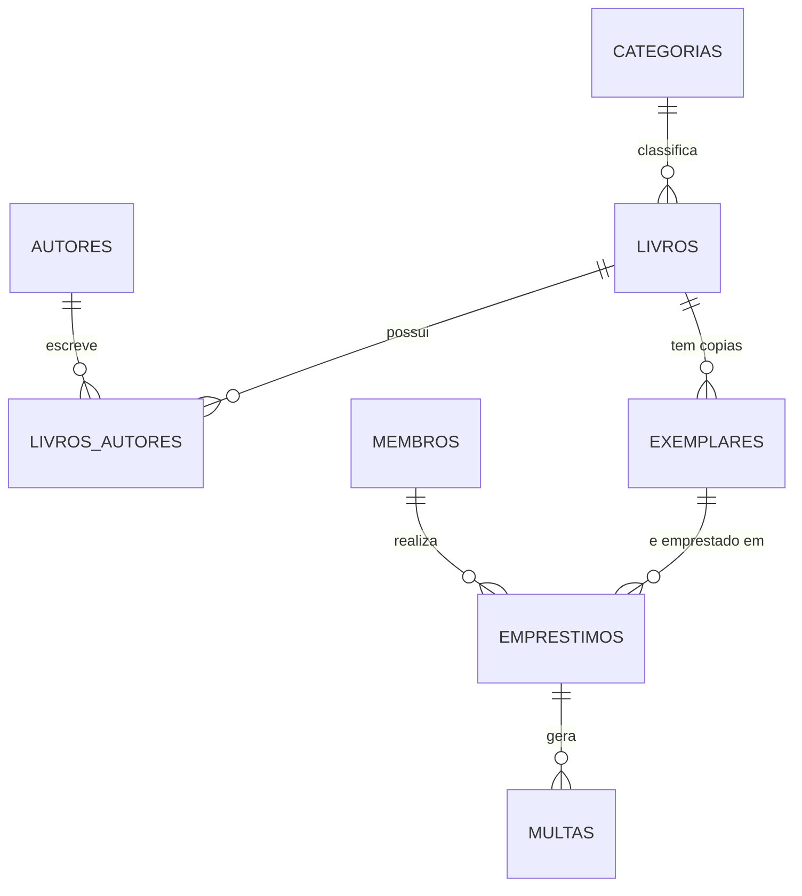

# 📚 Sistema de Gestão de Biblioteca (MySQL)

Sistema de gestão de biblioteca em MySQL: modelagem de dados, controle de empréstimos, permissões de usuários e backup automatizado.

Projeto de portfólio que une os conhecimentos de **Administração de Banco de Dados** e **Cibersegurança**, com foco em integridade dos dados, controle de acesso e rotinas de backup.

> ⚠️ **Aviso:** todos os dados deste projeto são **fictícios**. Nenhuma informação pessoal ou credencial real deve ser adicionada ao repositório.

---

## 🎯 Objetivos

- Modelar um banco de dados relacional completo, do zero.
- Garantir a **integridade** dos dados com chaves, restrições e validações.
- Aplicar o **princípio do menor privilégio**, criando usuários com permissões diferentes.
- Automatizar **backup e restauração** do banco.

## 🛠️ Tecnologias

- MySQL 8.0+
- SQL (DDL, DML, `GRANT`/`REVOKE`)
- Shell script (rotinas de backup)

## 🗂️ Estrutura do repositório

```
sistema-biblioteca-mysql/
├── README.md
├── docs/                      # diagramas e documentação
├── sql/
│   ├── 01_schema.sql          # criação do banco e das tabelas
│   ├── 02_seed.sql            # dados fictícios (em desenvolvimento)
│   ├── 03_queries.sql         # consultas e relatórios (em desenvolvimento)
│   └── 04_usuarios_permissoes.sql   # perfis de acesso (em desenvolvimento)
└── scripts/
    ├── backup.sh              # backup automatizado (em desenvolvimento)
    └── restore.sh             # restauração (em desenvolvimento)
```

## 🧩 Modelagem dos dados

O banco é composto por 8 tabelas:

| Tabela | Função |
|---|---|
| `categorias` | Categorias dos livros (ex.: Romance, Tecnologia) |
| `autores` | Autores cadastrados |
| `livros` | Catálogo de títulos |
| `livros_autores` | Relação N:N entre livros e autores |
| `exemplares` | Cópias físicas de cada livro, com status (disponível, emprestado, manutenção, perdido) |
| `membros` | Pessoas cadastradas na biblioteca |
| `emprestimos` | Registro de quem pegou qual exemplar e quando |
| `multas` | Cobranças geradas por atraso na devolução |

### Diagrama entidade-relacionamento



### Decisões de projeto

- **Separação entre livro e exemplar:** um mesmo título pode ter várias cópias físicas, cada uma com seu próprio status e código de barras.
- **Integridade referencial:** chaves estrangeiras com `ON DELETE RESTRICT` impedem apagar registros que ainda têm dependências (por exemplo, um livro com exemplares ou empréstimos).
- **Validações com `CHECK`:** ano de publicação plausível, datas de empréstimo coerentes e multas sem valor negativo.
- **Índices** nas colunas mais consultadas (título, status, datas de devolução) e restrições `UNIQUE` em ISBN, e-mail e código de barras.

## 🚀 Como executar

Pré-requisito: MySQL 8.0 ou superior instalado.

1. Clone o repositório:
   ```bash
   git clone https://github.com/biancamelo0905/sistema-biblioteca-mysql.git
   cd sistema-biblioteca-mysql
   ```
2. Crie o banco e as tabelas:
   ```bash
   mysql -u root -p < sql/01_schema.sql
   ```
3. Confira se tudo foi criado:
   ```sql
   USE biblioteca;
   SHOW TABLES;
   ```

## 🔐 Segurança (em desenvolvimento)

Planejado para as próximas etapas:

- **Perfis de acesso** com `GRANT`/`REVOKE`: administrador, leitura e escrita, seguindo o princípio do menor privilégio.
- **Backup automatizado** com script agendado, registro de log e teste de restauração.
- Boas práticas: nenhuma senha ou credencial real versionada no repositório.

## ✅ Roadmap

- [x] Modelagem e criação do esquema (`01_schema.sql`)
- [ ] Dados fictícios (`02_seed.sql`)
- [ ] Consultas, relatórios e uma *view* (`03_queries.sql`)
- [ ] Usuários e permissões (`04_usuarios_permissoes.sql`)
- [ ] Scripts de backup e restauração
- [ ] Diagrama ER exportado em imagem na pasta `docs/`

## 📖 O que aprendi

- Modelagem relacional e normalização de dados.
- Uso de restrições e índices para garantir integridade e desempenho.
- Noções de controle de acesso e proteção de dados em bancos de dados.

## 👩‍💻 Autoria

Feito por [@biancamelo0905](https://github.com/biancamelo0905).
