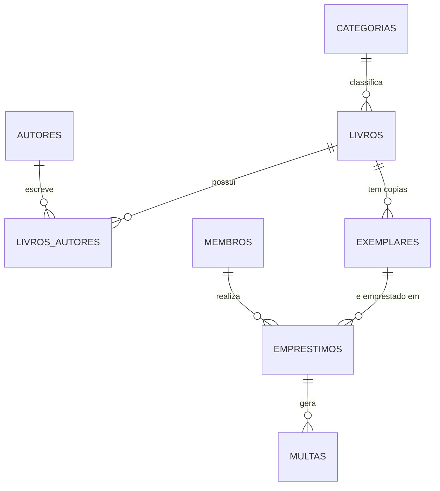

# Sistema de biblioteca em MySQL

Projeto de banco de dados que estou montando para praticar o que aprendi nos cursos de Administração de Banco de Dados e Introdução à Cibersegurança.

A ideia é simular o banco de uma biblioteca, com livros, autores, membros e empréstimos, controlar o acesso por tipo de usuário e fazer backup e restauração do banco.

Todos os dados são inventados.

## O que já está pronto

- `sql/01_schema.sql`: cria o banco e as 8 tabelas.
- `sql/02_seed.sql`: insere dados de exemplo para testar.
- `sql/03_queries.sql`: consultas úteis e uma view de empréstimos em aberto.
- `sql/04_usuarios_permissoes.sql`: três perfis de acesso (administrador, atendente e leitura), cada um com permissões diferentes.
- `scripts/backup.ps1`: backup do banco com data e hora no nome, registro em log e remoção de backups antigos.
- `scripts/restore.ps1`: restauração do banco a partir de um backup.

## O que ainda falta

- Agendar o backup para rodar sozinho (Agendador de Tarefas do Windows).

## Como rodar

## Backup e restauração

No PowerShell, a partir da pasta do projeto:

```powershell
powershell -ExecutionPolicy Bypass -File .\scripts\backup.ps1
powershell -ExecutionPolicy Bypass -File .\scripts\restore.ps1
```

A senha é pedida na hora e não fica salva em nenhum arquivo. Os backups vão para a pasta `backups/`, que não é enviada ao GitHub.

Precisa do MySQL 8.0 ou superior.

```bash
mysql -u root -p < sql/01_schema.sql
mysql -u root -p < sql/02_seed.sql
mysql -u root -p < sql/03_queries.sql
mysql -u root -p < sql/04_usuarios_permissoes.sql
```

As senhas do `04_usuarios_permissoes.sql` são só modelos para estudo. Troque por outras antes de usar em qualquer lugar de verdade.

## Como o banco está organizado



Separei **livro** de **exemplar** porque a biblioteca pode ter várias cópias do mesmo título, e cada cópia tem seu próprio status (disponível, emprestado, em manutenção ou perdido). Os empréstimos ficam ligados ao exemplar, não ao livro.

Usei chaves estrangeiras com `ON DELETE RESTRICT` para não deixar apagar, por exemplo, um livro que ainda tem empréstimos registrados, e alguns `CHECK` para evitar dados sem sentido, como data de devolução antes da data do empréstimo.
